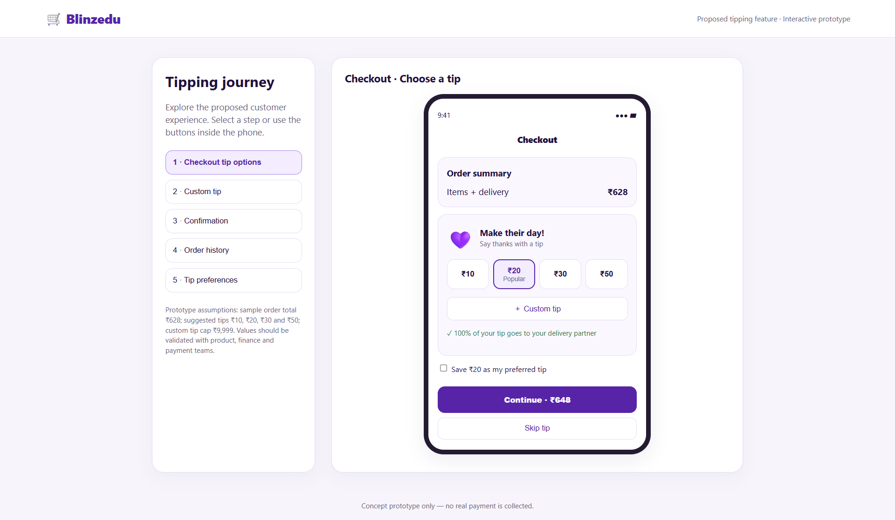
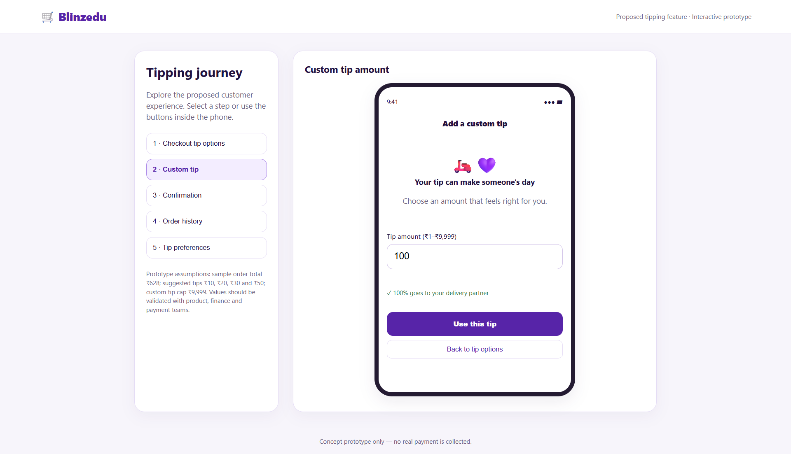
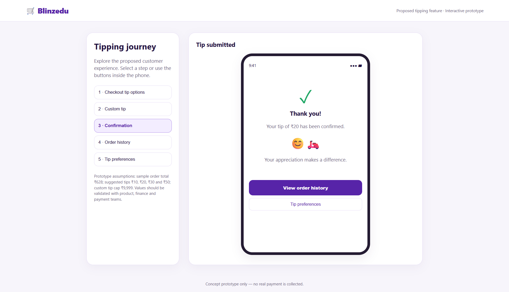
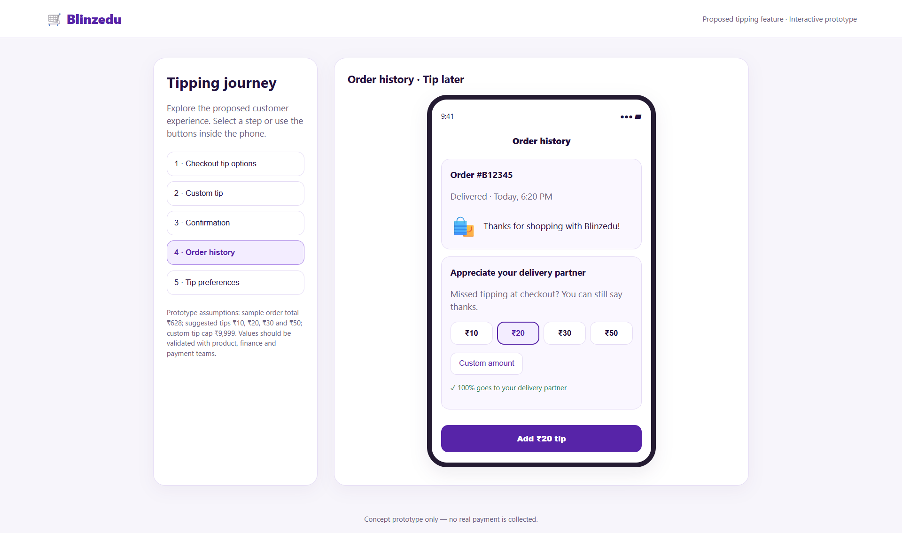
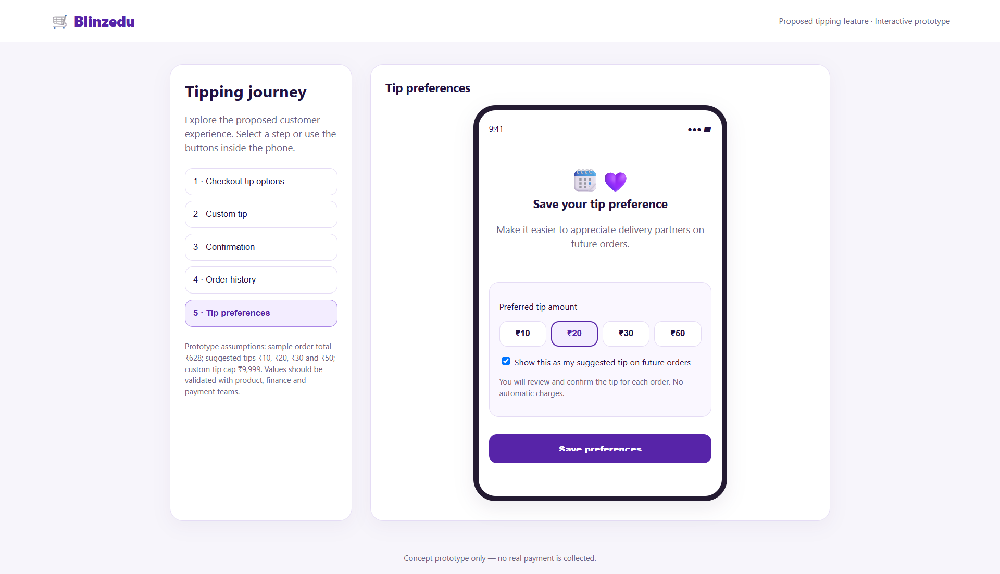
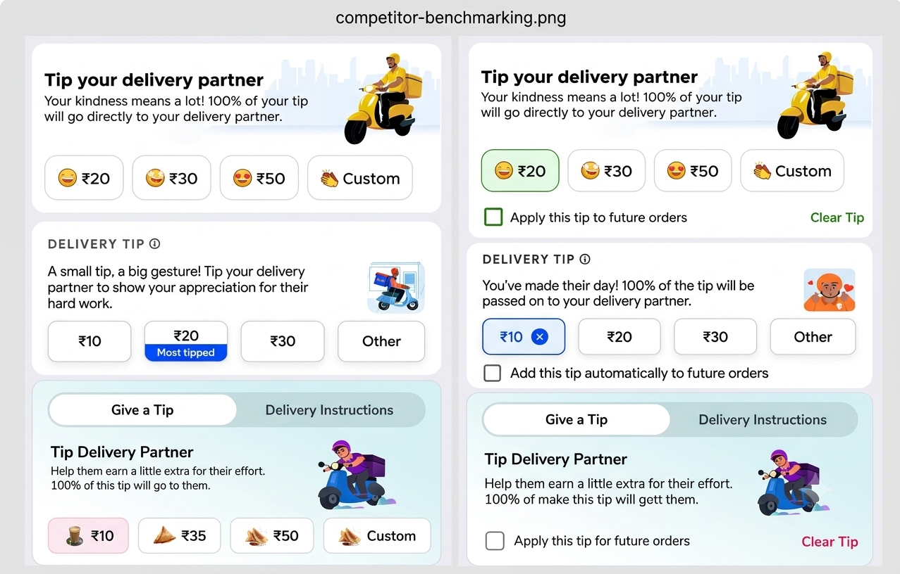
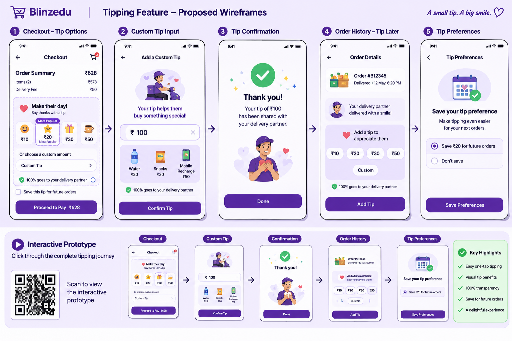

# Blinzedu – Hyperlocal Delivery App

[](LICENSE)
[](Blinzedu-PRD.md)
[](https://blinzedu-tipping-prototype.netlify.app/)

## Delivery Partner Tipping Feature

A product case study proposing an in-app tipping experience for **Blinzedu**, an Indian hyperlocal delivery platform focused on delivering groceries, household essentials, electronics, and other daily necessities within 10–20 minutes.

This repository documents the product requirements, customer experience, proposed technical requirements, success metrics, roadmap, and launch risks for introducing voluntary customer tips for delivery partners.

**Quick links:** [Read the full PRD](./Blinzedu-PRD.md) · [Open the live prototype](https://blinzedu-tipping-prototype.netlify.app/) · [View wireframes](#wireframe-gallery) · [License](#license)

> **Project type:** Product Management case study / Product Requirements Document (PRD)  
> **Contributor:** Gursimaran Kaur | PMF Cohort 52  
> **Planned launch in the PRD:** End of January

---

## Table of Contents

- [Overview](#overview)
- [Problem Statement](#problem-statement)
- [Product Goal](#product-goal)
- [Proposed Solution](#proposed-solution)
- [Key Features](#key-features)
- [Customer Journey](#customer-journey)
- [Wireframes and Prototype](#wireframes-and-prototype)
- [Technical Requirements](#technical-requirements)
- [Success Metrics](#success-metrics)
- [Product Roadmap](#product-roadmap)
- [Risks and Mitigations](#risks-and-mitigations)
- [Repository Structure](#repository-structure)
- [Project Documentation](#project-documentation)
- [License](#license)
- [Disclaimer](#disclaimer)

---

## Overview

Delivery partners are an essential part of the quick-commerce experience. They help customers receive their orders quickly while working through challenges such as traffic, weather conditions, long working hours, and varying customer expectations.

The proposed tipping feature gives customers a convenient, voluntary way to appreciate good delivery service. It also creates an opportunity for delivery partners to earn additional income and receive recognition for their efforts.

The experience is designed around three principles:

- **Voluntary appreciation:** Customers remain in control and can skip tipping.
- **Transparency:** The experience clearly communicates that 100% of the tip goes to the delivery partner.
- **Convenience:** Customers can choose a suggested amount or enter a custom amount.

## Problem Statement

Blinzedu delivery partners may have limited opportunities to earn additional income and receive recognition for their efforts. At the same time, satisfied customers may not have a convenient way to reward delivery partners for good service.

Blinzedu needs a simple and transparent tipping experience that bridges this gap without making tipping feel mandatory.

## Product Goal

Introduce a tipping feature that:

1. Makes it easy for customers to appreciate delivery partners.
2. Provides delivery partners with an opportunity to earn additional income.
3. Offers a simple, secure, and transparent payment experience.
4. Supports tipping during checkout and, for eligible completed orders, through Order History.
5. Gives customers control over saved tip preferences.

## Proposed Solution

Add a tipping section to the customer checkout experience, positioned between **Coupon Code** and **Payment Details**.

Customers can select one of the suggested amounts or enter a custom amount. They can review the order total, including the tip, before confirming payment.

Customers who skip tipping at checkout can be offered an opportunity to tip later through eligible completed orders in Order History.

The proposed experience also includes tip confirmation, delivery partner notifications, and optional saved tip preferences. A saved preference is a suggestion only: **a tip must never be charged without the customer's confirmation for that order.**

## Key Features

| Feature | Description | Proposed priority |
|---|---|---|
| Predefined tip amounts | Offer ₹10, ₹20, ₹30 and ₹50 as suggested amounts. | P0 – MVP |
| Custom tip | Let customers enter an amount between ₹1 and ₹9,999. | P0 – MVP |
| 100% tip transparency | Clearly state that 100% of the tip goes to the delivery partner. | P0 – MVP |
| Secure tip payment | Process the tip payment and track its status. | P0 – MVP |
| Tip confirmation | Show a thank-you message after successful tip submission. | P0 – MVP |
| Delivery partner notification | Notify the delivery partner when a tip is credited. | P0 – MVP |
| Most Popular label | Highlight the most frequently selected tip amount. | P1 – Phase 2 |
| Tip benefit icons | Use visual icons to illustrate what tips can help delivery partners purchase. | P1 – MVP/Phase 2 |
| Saved tip preference | Allow customers to save, modify, or disable a preferred tip amount. | P1 – Phase 2 |
| Order History tipping | Allow tipping for eligible completed orders after checkout. | P1 – Phase 2 |
| Advanced analytics | Expand analysis of tipping behaviour and performance. | P2 – Phase 3 |
| Personalised suggestions | Explore personalised tipping suggestions. | P2 – Phase 3 |

## Customer Journey

### Checkout tipping flow

1. Customer adds products to the cart.
2. Customer proceeds to checkout.
3. Tipping section appears between Coupon Code and Payment Details.
4. Customer views suggested tip amounts and icons.
5. Customer selects a suggested amount or enters a custom amount.
6. Customer reviews the total order amount, including the tip.
7. Customer confirms payment.
8. Tip transaction is processed.
9. Customer receives a thank-you message.
10. Delivery partner receives a tip notification.

### Order History tipping flow

1. Customer opens Order History.
2. Customer selects an eligible completed order.
3. Customer chooses to tip the delivery partner.
4. Customer selects a suggested or custom amount.
5. Customer confirms the tip payment.
6. Delivery partner receives a notification.
7. Customer receives a confirmation message.

### Saved tip preference flow

1. Customer selects a preferred tip amount.
2. Customer enables Save Tip Preference.
3. The preference is saved.
4. The saved amount appears as a suggestion at future checkouts.
5. Customer can modify or disable the preference at any time.
6. No tip is charged without confirmation for the individual order.

## Wireframes and Prototype

The proposed mobile experience covers five screens:

1. **Checkout – Tip Options**
2. **Custom Tip Input**
3. **Tip Confirmation**
4. **Order History – Tip Later**
5. **Tip Preferences**

### Interactive prototype

Explore the clickable customer journey:

**[Open Blinzedu Tipping Prototype](https://blinzedu-tipping-prototype.netlify.app/)**

### Wireframe gallery

<table>
  <tr>
    <td align="center" width="33%">
      <br>
      <strong>Checkout – Tip Options</strong>
    </td>
    <td align="center" width="33%">
      <br>
      <strong>Custom Tip Input</strong>
    </td>
    <td align="center" width="33%">
      <br>
      <strong>Tip Confirmation</strong>
    </td>
  </tr>
  <tr>
    <td align="center" width="33%">
      <br>
      <strong>Order History – Tip Later</strong>
    </td>
    <td align="center" width="33%">
      <br>
      <strong>Tip Preferences</strong>
    </td>
    <td align="center" width="33%">
      <br>
      <strong>Competitor Benchmarking</strong>
    </td>
  </tr>
</table>

### Full wireframe overview



All wireframes and supporting screenshots are available in the [`assets/`](./assets) folder.

## Technical Requirements

The PRD proposes the following API endpoints to support tipping. These are **proposed interface examples**, not confirmation that the APIs have been implemented.

| Method | Proposed endpoint | Purpose |
|---|---|---|
| POST | `/api/v1/orders/{order_id}/tip` | Submit a tip for a specific order. |
| GET | `/api/v1/users/{user_id}/tips/preferences` | Retrieve saved tipping preferences. |
| POST | `/api/v1/users/{user_id}/tips/preferences` | Save or update a preferred tip amount. |
| GET | `/api/v1/tips/history` | Retrieve customer tipping transaction history. |
| GET | `/api/v1/delivery-partners/{partner_id}/tips` | Retrieve tips received by a delivery partner. |
| POST | `/api/v1/notifications/tip` | Trigger a delivery partner tip notification. |

### Proposed data entities

**`order_tips`**

| Field | Purpose |
|---|---|
| `tip_id` | Unique tip transaction identifier. |
| `order_id` | Associated order identifier. |
| `user_id` | Customer identifier. |
| `delivery_partner_id` | Delivery partner identifier. |
| `tip_amount` | Tip amount. |
| `payment_status` | Pending, Successful, Failed, or Refunded. |
| `created_at` | Tip submission timestamp. |

**`user_tip_preferences`**

| Field | Purpose |
|---|---|
| `preference_id` | Unique preference identifier. |
| `user_id` | Customer identifier. |
| `preferred_tip_amount` | Saved tip amount. |
| `preference_enabled` | Whether the preference is enabled. |
| `updated_at` | Last update timestamp. |

### Analytics events

The proposed event instrumentation includes:

- `tip_checkout_viewed`
- `tip_option_selected`
- `custom_tip_entered`
- `tip_skipped`
- `tip_confirmed`
- `tip_preference_saved`
- `tip_post_delivery_clicked`
- `tip_payment_failed`
- `tip_notification_received`

These events are intended to help measure feature visibility, tip selection, conversion, preference adoption, payment reliability, and notification delivery.

## Success Metrics

The PRD identifies **Tip Conversion Rate** as the North Star Metric.

### North Star Metric

**Tip Conversion Rate** measures the percentage of eligible completed orders that receive a successful customer tip.

```text
Tip Conversion Rate =
(Number of successfully tipped orders / Total eligible completed orders) × 100
```

Example:

- Eligible completed orders: 10,000
- Orders receiving tips: 2,000
- Tip Conversion Rate: 20%

### Proposed primary targets

| Metric | Proposed target |
|---|---:|
| Tip Conversion Rate | 15–20% |
| Repeat Tipping Rate | 30% |
| Tip Payment Success Rate | 98% or above |

These are proposed targets from the PRD, not measured results.

### Supporting metrics

- Tip Adoption Rate
- Average Tip Amount
- Total Tips Collected
- Custom Tip Selection Rate
- Order History Tip Conversion
- Delivery Partner Satisfaction
- Customer Satisfaction (CSAT)
- Tip Skip Rate
- Average Additional Earnings per Delivery Partner
- Preference Adoption
- Refund Rate

### Measurement timeline

| Period | Measurement focus |
|---|---|
| Week 1–2 | Feature adoption, tip conversion, and payment success. |
| Week 3–4 | Average tip amount, popular tip selections, and customer feedback. |
| Month 2 | Repeat tipping, delivery partner earnings, and satisfaction. |
| Month 3 | Overall business impact and opportunities for improvement. |

## Product Roadmap

| Phase | Timeline | Key activities |
|---|---|---|
| Research & Planning | Week 1 | Competitor analysis, customer research, delivery partner feedback, requirements, and success metrics. |
| UI/UX Design | Week 2 | Checkout tipping interface, suggested amounts, custom input, confirmation, and Order History flow. |
| Development | Week 3–4 | Frontend and backend APIs, payment gateway integration, preferences, and notifications. |
| Testing & QA | Week 5 | Functional, payment, usability, refund, edge-case, and cross-device testing. |
| Launch | Week 6 | Release the feature and communicate updates to customers and delivery partners. |
| Monitoring & Optimisation | Week 7–8 | Analyse conversion, tip amount, feedback, partner satisfaction, and payment success. |

### Launch approach

1. **Internal testing:** Validate payment processing, tip transfers, and usability.
2. **Pilot launch:** Release to a limited customer group and gather customer and delivery partner feedback.
3. **Full launch:** Roll out to eligible customers and educate delivery partners.
4. **Post-launch optimisation:** Monitor performance, identify drop-offs, and improve the experience.

## Risks and Mitigations

| Risk | Potential impact | Mitigation |
|---|---|---|
| Low customer adoption | Low tipping conversion and limited additional partner earnings. | Use clear suggested amounts and friendly, non-intrusive messaging. |
| Payment failure | Poor experience and unsuccessful transactions. | Add payment retries, transaction tracking, and clear error messages. |
| Duplicate transactions | Unintended charges and customer complaints. | Use unique transaction IDs and idempotency checks. |
| Delayed tip transfer | Reduced delivery partner trust. | Establish reconciliation, transaction tracking, and timely payouts. |
| Customer confusion | Customers may perceive tipping as mandatory. | Clearly label tipping as optional and provide a Skip option. |
| Accidental future tipping | Unwanted charges and dissatisfaction. | Require confirmation for every order; make preferences easy to manage. |
| Fraudulent transactions | Financial losses and operational overhead. | Apply transaction validation, fraud monitoring, and refund policies. |
| Incorrect partner assignment | Tips may reach the wrong delivery partner. | Credit the verified partner who completed the delivery. |
| Order cancellation | Incorrect allocation or refund disputes. | Refund tips when applicable and prevent crediting tips for cancelled orders. |
| Negative customer perception | Reduced trust in the brand. | Avoid guilt-based prompts and keep tipping voluntary. |

### Technical risk controls

- Monitor API availability and implement retry mechanisms.
- Encrypt sensitive transaction data and follow secure payment practices.
- Test across commonly used Android and iOS devices.
- Retry failed notifications without duplicating tip transactions.
- Validate tip amounts and payment calculations before launch.

## Repository Structure

```text
NextLeap-Assignment-Blinzedu-PRD-06-November-2026/
├── README.md
├── Blinzedu-PRD.md
├── LICENSE
└── assets/
    ├── wireframes/
    │   ├── checkout-tip-options.png
    │   ├── custom-tip-input.png
    │   ├── tip-confirmation.png
    │   ├── order-history-tip.png
    │   ├── tip-preferences.png
    │   └── blinzedu-tipping-wireframes.png
    └── screenshots/
        └── competitor-benchmarking.png
```

All wireframe images and the competitor benchmarking screenshot are committed in the [`assets/`](./assets) folder and embedded in the [wireframe gallery](#wireframe-gallery).

## Project Documentation

The detailed product requirements are available here:

**[Blinzedu-PRD.md](./Blinzedu-PRD.md)**

The PRD covers the product context, competitor benchmarking, customer experience, user flows, acceptance criteria, proposed APIs and database schema, analytics, success metrics, roadmap, and risk mitigations.

| Resource | Description |
|---|---|
| [Blinzedu-PRD.md](./Blinzedu-PRD.md) | Full Product Requirements Document for the tipping feature. |
| [Live prototype](https://blinzedu-tipping-prototype.netlify.app/) | Clickable mobile walkthrough of the proposed customer journey. |
| [Wireframe gallery](#wireframe-gallery) | Checkout, custom tip, confirmation, Order History, and preference screens. |
| [Competitor benchmarking](./assets/screenshots/competitor-benchmarking.png) | Reference comparison used during product research. |

## License

This project is licensed under the [MIT License](./LICENSE).

Copyright © 2026 Gursimaran Kaur.

You are free to use, copy, modify, and distribute this work, including for commercial purposes, provided that the copyright notice and permission notice are included. The work is provided "as is", without warranty of any kind.

## Disclaimer

This repository documents a proposed product solution prepared as a Product Management case study. Feature behaviour, API endpoints, database entities, targets, and timelines describe the proposal in the PRD; they should not be interpreted as confirmation of a live production implementation or actual business performance.
